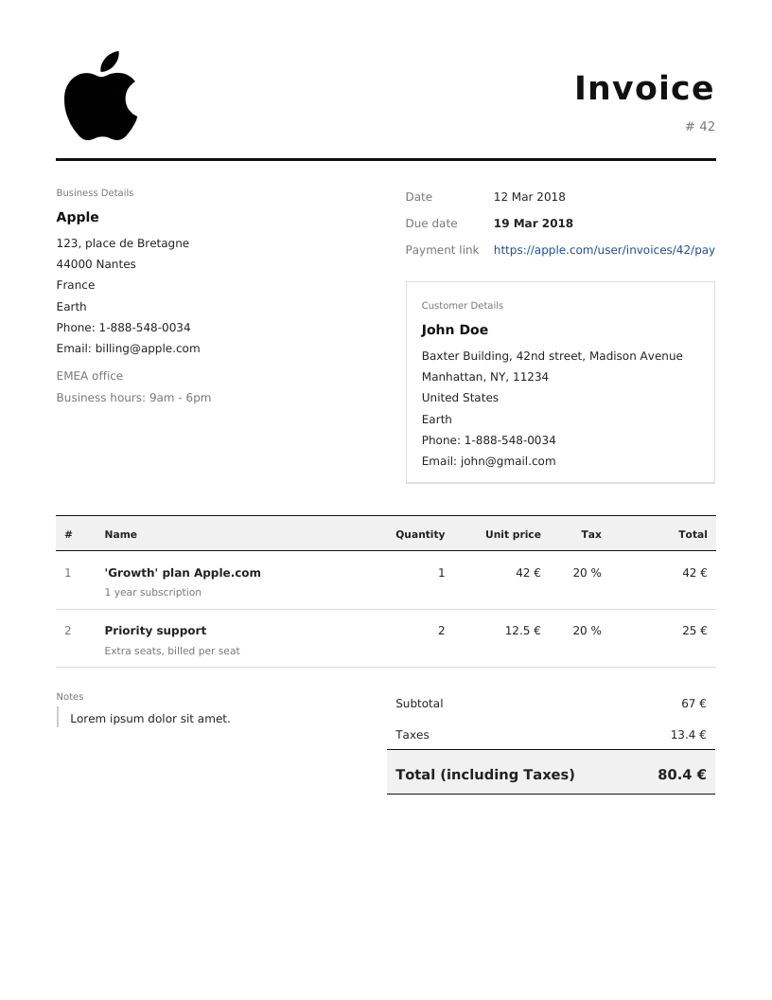

# Invoice as a service

[](https://github.com/samber/invoice-as-a-service/actions/workflows/tests.yaml)
[](LICENSE)

Generate a PDF invoice from one JSON `POST`. Self-host it or use the hosted endpoint.

Built with Laravel 13 and PHP 8.5, rendered with dompdf. Actively maintained, MIT licensed.



[Example PDF](example.pdf)

## Quick start

Send the smallest valid payload to the hosted endpoint:

```sh
curl "https://invoice-as-a-service.cleverapps.io/api/invoice/generate" \
  -X POST -H "content-type: application/json" \
  -o invoice.pdf \
  -d '{
    "id": "42",
    "currency": "€",
    "lang": "en",
    "date": 1520852472,
    "due_date": 1521457272,
    "items": [{ "title": "Growth plan", "price": 42, "tax": 20 }],
    "customer": { "summary": "John Doe", "address_line_1": "1 Main Street" },
    "company": { "summary": "Acme", "address_line_1": "2 High Street" }
  }'
```

The response is the PDF (`201`, `application/pdf`). Open `invoice.pdf`.

The hosted endpoint is run best effort, without an SLA. It receives your invoice data and any FTP or webhook credentials you put in the payload. Self-host when that matters.

## Self-host

Requirements: PHP 8.5 with the `gd` extension, and Composer.

```sh
composer install
php artisan serve
```

Then run the same request against `http://localhost:8000/api/invoice/generate`.

Optional features read their settings from environment variables. Copy `.env.dist` to `.env` and set the `MAIL_*` variables to enable email. See [PDF signature](docs/API.md#pdf-signature) for signing.

## Where the PDF goes

The PDF is always returned in the HTTP response. Add an object to the payload to also send it to:

- AWS S3, or any S3-compatible storage, through a presigned URL (`s3`)
- an FTP server (`ftp`)
- a webhook (`webhook`)
- an email, with the PDF attached, through your SMTP server (`email`)
- Zapier, through a "Catch hook" trigger, to reach Drive, Dropbox and others (`zapier`)

## What it is not

It renders one invoice per request from the data you send. It stores no invoices, keeps no customers or invoice numbers, and computes no payments. Use an accounting tool for those.

## Reference

- [API reference](docs/API.md): every property, destination option, PDF metadata and PDF signature.
- [Invoice form](https://crocomo2744.github.io/Invoicing-form/): a user interface by a contributor.

## Contribute

Issues and pull requests are welcome. Where to start:

- template: `resources/views/invoices/default.blade.php`
- controller and input validation: `app/Http/Controllers/InvoiceController.php`
- PDF build: `app/Helpers/PDF.php`
- file storage: `app/Helpers/Storage.php`

Run the tests with `vendor/bin/phpunit`.

Generate a presigned S3 upload URL for testing:

```sh
aws configure
node ./scripts/presign-upload-url.js <region> <my-bucket> invoices/201807250018--foobar@example.com.pdf
```

Update dependencies:

```sh
composer outdated -D
composer update <package-name> --with-dependencies
```

## License

[MIT](LICENSE)
